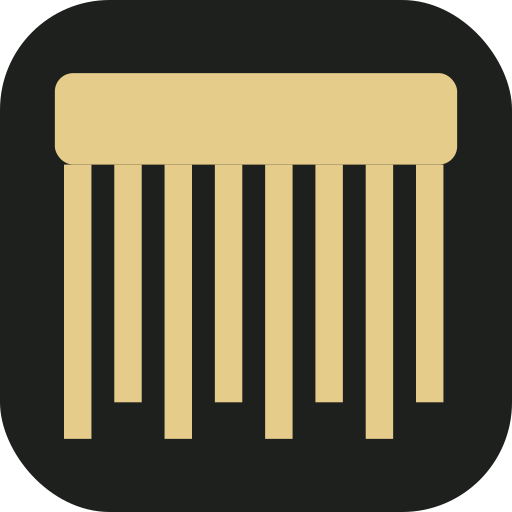
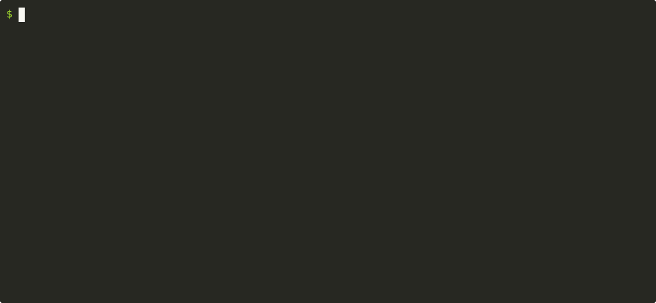
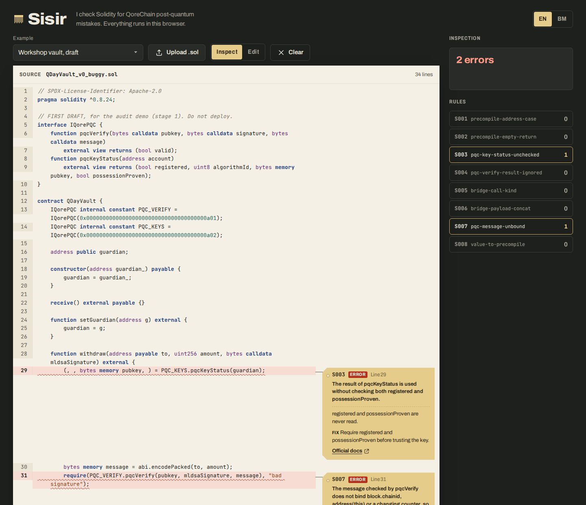
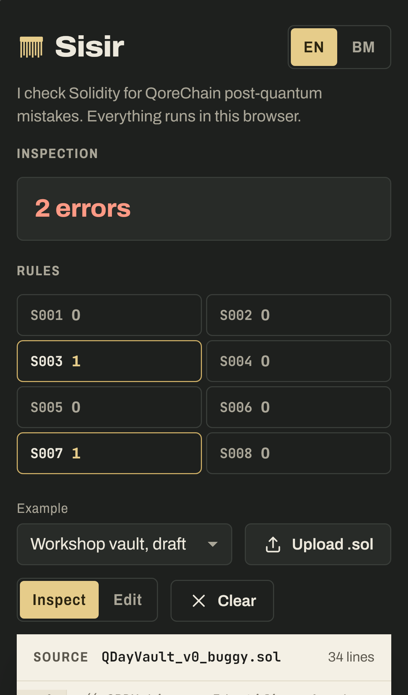

<p align="center"></p>

<h1 align="center">Sisir</h1>

<p align="center"><a href="https://github.com/aimanmalib/sisir/actions/workflows/ci.yml"></a> <a href="https://github.com/aimanmalib/sisir/blob/main/LICENSE"></a>  </p>

<p align="center"><b>A linter for QoreChain Solidity. It catches post-quantum mistakes before you deploy.</b> · <i>Linter untuk Solidity QoreChain. Ia menangkap kesilapan pasca-kuantum sebelum anda deploy.</i><br>
<a href="https://sisir.sasateguh.com"><b>playground</b></a> · <a href="#try-it">try it</a> · <a href="#the-eight-rules">the eight rules</a> · <a href="#limits">limits</a> · <a href="AI_USAGE.md">AI usage</a> · <a href="CHANGELOG.md">changelog</a> · <a href="#bahasa-melayu">Bahasa Melayu</a><br>
Built in Malaysia by <a href="https://aimanmalib.com">Aiman Malib</a> · <a href="https://sasateguh.com">Sasa Teguh</a></p>

<p align="center"></p>

The fest FAQ says jurors check post-quantum calls in Solidity by hand. Sisir does that check with one command.

QoreChain gives Solidity contracts precompiles for post-quantum keys and signatures (`pqcKeyStatus`, `pqcVerify`) and
a bridge to the Native lane at `0x…0901`. The docs and the workshops list the ways these go wrong: trusting a key
without proof of possession, ignoring the result of `pqcVerify`, signing a message that can be replayed, calling the
bridge with the wrong kind of call. Sisir reads your contracts and flags eight of these mistakes. Every finding gives
the file and line, one sentence on the problem, one sentence on the fix, and a link to the official page it comes from.

I built Sisir for Build Before Q-Day: The QoreChain Developer Fest, in the Quantum Pass category. It complements the
official AI auditor. It does not replace an audit.

## Try it

You need Node.js 20.10 or later. From the folder that holds your contracts:

```sh
npx github:aimanmalib/sisir contracts/
```

npm installs Sisir from this repository and builds it on the way. Pass any mix of `.sol` files and folders.

```text
Usage: sisir [options] <file-or-folder>...

Options:
  -f, --format <text|json|sarif>  output format (default: text)
      --no-color                  plain text output
  -v, --version                   print the version
  -h, --help                      print this help

Exit codes: 0 no error-level findings, 1 error-level findings, 2 parse or usage error.
```

The exit code makes it a CI step: the job fails when there is an error. `--format sarif` writes `SARIF` 2.1.0, which
GitHub code scanning and most editors read. `--format json` gives the same findings for your own scripts.

### In GitHub Actions

Sisir is also a composite Action. It prints the findings in the job log, uploads the `SARIF` report to code scanning
so each finding shows on its line in a pull request, and fails the step on an error-level finding.

```yaml
permissions:
  contents: read
  security-events: write
steps:
  - uses: actions/checkout@v4
  - uses: aimanmalib/sisir@main # pin a commit SHA in your own workflow
    with:
      paths: contracts/src
```

Inputs: `paths` (spaces or new lines, default `.`), `upload-sarif` (default `true`, skipped on pull requests from
forks), `category` (default `sisir`), `fail-on-error` (default `true`). Outputs: `exit-code` and `sarif-file`. The
runner needs Node.js 20.10 or later, which GitHub's Ubuntu runners have. Sisir's own CI runs the Action on
`contracts/src` and checks that the workshop draft fails it.

To work on Sisir itself:

```sh
git clone --recurse-submodules https://github.com/aimanmalib/sisir.git
cd sisir
npm ci
node dist/cli.js fixtures/workshop
```

Or open the [playground](https://sisir.sasateguh.com): paste or upload a `.sol` file and the findings appear in the
browser. Your code is not sent to a server.

## The eight rules

| Id | Level | Catches | Source |
|---|---|---|---|
| S001 | warning | A precompile address written in mixed case | [build.qorechain.io/faq](https://build.qorechain.io/faq) |
| S002 | error | A low-level call to a precompile that uses the return data without checking its length | [EVM precompiles](https://docs.qorechain.io/developer-guide/evm-precompiles) |
| S003 | error | A `pqcKeyStatus` result used without checking `registered` and `possessionProven` | [EVM precompiles](https://docs.qorechain.io/developer-guide/evm-precompiles) |
| S004 | error | The result of `pqcVerify` is ignored, or only the call status is read | [Workshop 2](https://docs.qorechain.io/build-before-qday/workshop-2) |
| S005 | error | The bridge at `0x…0901` called with `staticcall`, `delegatecall` or value | [Cross-VM reference](https://docs.qorechain.io/developer-guide/cross-vm-reference) |
| S006 | warning | A bridge payload built by concatenating a `string` or `bytes` parameter the function never validates | [Workshop 3](https://docs.qorechain.io/build-before-qday/workshop-3) |
| S007 | error | A message checked by `pqcVerify` that does not bind `block.chainid`, `address(this)` or a changing counter | [Workshop 2](https://docs.qorechain.io/build-before-qday/workshop-2) |
| S008 | error | Value sent to a precompile address | [EVM precompiles](https://docs.qorechain.io/developer-guide/evm-precompiles) |

[`docs/rules.md`](docs/rules.md) explains each rule, with what it does not catch. Every rule has at least two
positive and two negative cases in [`fixtures/rules/`](fixtures/rules), and a test that names the rule. The rule text,
level and link live in [`src/rules/catalog.json`](src/rules/catalog.json); the precompile and bridge addresses live in
[`src/rules/qorechain.json`](src/rules/qorechain.json). There is no general Solidity rule here. Other tools already
cover those.

## Before and after: the workshop 2 vault

Workshop 2 of the fest audits a small vault with the official auditor and then fixes it. I copied both versions
unchanged into [`fixtures/workshop/`](fixtures/workshop) (Apache-2.0, credited in [`NOTICE`](NOTICE)).

| File | Errors | Warnings | Findings |
|---|---|---|---|
| `QDayVault_v0_buggy.sol` (first draft) | 2 | 0 | S003 line 29, S007 line 31 |
| `QDayVault_v1_fixed.sol` (fixed) | 0 | 0 | none |

Both draft findings match the workshop's own audit notes. S007 is the replay finding: the signed message does not bind
the chain, the contract or a nonce. S003 is the key check the notes list as fixed. The other draft findings in those
notes are general Solidity issues, which I leave to other tools. `test/workshop.test.ts` checks these numbers and the
file hashes on every run.

## The playground

[sisir.sasateguh.com](https://sisir.sasateguh.com) runs the same rule engine as the CLI, bundled for the browser. It
opens on the workshop draft, with each finding tied to its line. You can load the fixed vault, edit the code, paste
your own, or upload a file. It is in English and Bahasa Melayu.

<p align="center"> </p>

The playground starts from the Quantum Pass scaffold. The first commit of `web/`,
[`25dbb74`](https://github.com/aimanmalib/sisir/commit/25dbb74), is the unchanged output of:

```sh
npx create-qorechain-dapp@0.14.0 web --template viem-wagmi --network testnet --package-manager npm --yes --no-install
```

[`docs/decisions/0003-web-scaffold.md`](docs/decisions/0003-web-scaffold.md) records the version, the date and how to
check it. Later commits build on that scaffold and never rewrite it.

Below the code there is a ledger band. It connects QoreX through RainbowKit, opens an EVM access window with one
hybrid-signed `MsgOpenEVMWindow` from QoreX, and then calls `SisirLedger.anchor(reportHash, sourceHash, findings)`.
The report hash leaves out the message text, so the English and Malay reports give the same hash, and the CLI computes
it the same way ([`src/report/hash.ts`](src/report/hash.ts)). Recent anchors are read from the public EVM RPC, with no
wallet needed. [`docs/decisions/0006-anchor-flow.md`](docs/decisions/0006-anchor-flow.md) has the details.

## SisirLedger

[`contracts/src/SisirLedger.sol`](contracts/src/SisirLedger.sol) keeps a public record of inspections. `anchor` only
accepts an account that is quantum-ready: it reads `pqcKeyStatus` and requires both `registered` and
`possessionProven`, and it treats an empty answer from the precompile as a refusal. It emits `Anchored` and keeps the
latest anchors for reading. It has no owner, no pause, no upgrade and no payable function. Sisir reports no findings
on it.

SisirLedger is not on the testnet yet. Until its address is in [`config/app.json`](config/app.json), the anchor
buttons in the playground are off and the page says why.

## Tests

| Suite | Tests | What it covers |
|---|---|---|
| CLI and rules (vitest) | 109 | every rule on its fixtures, the workshop vault, the three output formats against the `SARIF` 2.1.0 schema, exit codes, broken files, the report hash, the deploy script |
| Playground (vitest) | 23 | components, the Malay and English text, code highlighting, the window message bytes |
| Playground end to end (Playwright) | 4 | the anchor flow in Chromium against the QoreX test wallet and a fake chain, for the wallet as it is today and as planned |
| SisirLedger (Foundry) | 14 | a quantum-ready account, no proof, no key, an empty, missing or reverting precompile, the latest list, and fuzzed hashes and accounts |

The numbers are from the last full run of [`scripts/gerbang-ujian.sh`](scripts/gerbang-ujian.sh), which CI runs. It
also type-checks, builds the playground and scans the history for secrets.

## Limits

- Every rule is a syntax heuristic over one file. Sisir does not follow data across functions or contracts and does
  not run the code. It will miss a mistake that is spread over two functions, and it can flag code that is safe for a
  reason it cannot see. [`docs/rules.md`](docs/rules.md) lists what each rule does not catch.
- Eight rules is a short list. They are the QoreChain-specific mistakes the docs and workshops name. Sisir is not a
  general Solidity linter and not an audit.
- QoreX does not sign EVM transactions yet. In the playground, opening the window works through QoreX's native lane,
  and the `anchor` call is refused by the wallet with a plain message. The end-to-end test drives the flow with the
  official QoreX test wallet and a fake chain. No test drives the real QoreX extension.
- QoreX uses different accounts for the native and EVM lanes. A window opened from the native lane covers the native
  account's address, and the page shows which address that is.
- Testnet only. Nothing here is meant for mainnet.

## AI disclosure

I built Sisir with AI coding agents (Claude Code). Almost all of the code, tests, documents and images in this
repository were generated by them, under my plan and my decisions, and checked by automated gates and a separate
reviewer agent before each commit was accepted. [`AI_USAGE.md`](AI_USAGE.md) describes the workflow, the generated work
and my contribution.

## Built during the fest

The first commit, [`de22e99`](https://github.com/aimanmalib/sisir/commit/de22e99), is from 22 November 2026, during
the fest. Every change since then is in the history, in small commits, with a decision record for each choice in
[`docs/decisions/`](docs/decisions).

## Credits

- The workshop 2 vault in `fixtures/workshop/` is from [qorechain/build-before-qday](https://github.com/qorechain/build-before-qday)
  (Apache-2.0). The source commit and file hashes are in [`fixtures/workshop/README.md`](fixtures/workshop/README.md).
- The playground starts from [`create-qorechain-dapp`](https://www.npmjs.com/package/create-qorechain-dapp) 0.14.0 and
  uses the QoreChain kits `@qorechain/evm`, `@qorechain/qorex-rainbowkit` and `@qorechain/qorex-types`, with
  `@qorechain/qorex-wallet-mock` in tests.
- [`@solidity-parser/parser`](https://github.com/solidity-parser/parser) (MIT) parses the Solidity.
- [RainbowKit](https://rainbowkit.com), [wagmi](https://wagmi.sh), [viem](https://viem.sh), React and Vite run the
  playground. [Foundry](https://getfoundry.sh) builds and tests the contract.
- The `SARIF` 2.1.0 schema used in tests is the official schema, copied unchanged (see `NOTICE`).

Full notices are in [`NOTICE`](NOTICE). Other packages keep their own licences and are listed with their versions in
`package.json` and `web/package.json`.

## Contributing

Issues and pull requests are welcome. See [`CONTRIBUTING.md`](CONTRIBUTING.md). To report a security issue, see
[`SECURITY.md`](SECURITY.md).

## Licence

[Apache License 2.0](LICENSE). Copyright 2026 Aiman Malib.

## Bahasa Melayu

Sisir ialah linter untuk kontrak Solidity di QoreChain. Ia menyemak lapan kesilapan pasca-kuantum dan jambatan
Cross-VM sebelum anda deploy, dan setiap dapatan memaut ke dokumen rasmi. Cuba dalam pelayar, dalam Bahasa Melayu, di
[sisir.sasateguh.com/?lang=ms](https://sisir.sasateguh.com/?lang=ms). Dokumentasi lain dalam repositori ini dalam
bahasa Inggeris.
